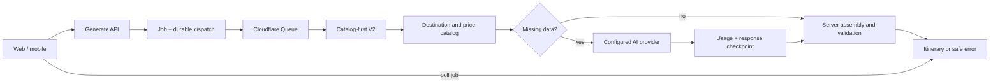

# Production planning canary and provider selection

## Release contract

No staging environment is required. The original V1/V2 rollout procedure below starts at `PLANNING_V2_PERCENT=0`; it is historical for the existing production rollout, which was already at 100% V2 when verified on 2026-11-19. For provider changes on the existing rollout, preserve the current percentage, restrict the candidate fallback to the dedicated CI account, and do not enable it for other users until real production canary cases pass. Verify the current setting before each deployment. Producer, consumer, DLQ and global AI concurrency start at one. A health check does not certify generation.

Production jobs pin their pipeline. A failed canary blocks promotion; it never reroutes V2 jobs to V1. Existing pinned jobs retain their Queue, checkpoint and ledger. Do not switch new jobs back to V1 as an automatic recovery step. The bounded canary does not certify 100-account capacity or a population success rate.

## Configuration

The GitHub `production` environment needs `CLOUDFLARE_API_TOKEN`, `CLOUDFLARE_MIGRATION_DATABASE_URL`, `PLANNING_CANARY_EMAIL` and `PLANNING_CANARY_PASSWORD` secrets. The dedicated account is created through the ordinary native registration API if it does not exist. Its UUID is configured as the backend canary allowlist for that deployment. Only the dedicated CI account is configured; no personal account receives override access.

`X-Planning-Pipeline: v1|v2` is accepted only after JWT authentication for an allowlisted user; others receive 403. The override is not a frontend feature. No provider/key is accepted from the request. Use a distinct idempotency key for each case and pipeline; reuse it when recovering a runner interruption. Do not resubmit with a different key automatically.

| Provider variable `AI_PROVIDER` | Model variable | API secret |
| --- | --- | --- |
| `cloudflare` (default) | `CLOUDFLARE_AI_MODEL` (existing Llama default) | Workers AI binding |
| `claude` | `ANTHROPIC_MODEL` | `ANTHROPIC_API_KEY` |
| `openai` | `OPENAI_MODEL` | `OPENAI_API_KEY` |
| `gemini` | `GEMINI_MODEL` | `GEMINI_API_KEY` |

Set these as GitHub production environment variables/secrets. The workflow validates the selected model and syncs available third-party secrets using a private temporary file. Missing keys/models fail before dispatch. V2 never silently selects Mock or another provider. Synthetic staging mocks remain explicitly restricted to `PLANNING_STAGING=true`.

The external adapters send one HTTPS request with a 120-second timeout and no automatic retry. Cloudflare binding requests use the same 120-second ledger deadline. An unresolved binding call retains its capacity lease until it settles and cannot be dispatched again. Raw business content is persisted before JSON validation. Timeout/unknown response consumes the dispatch ticket, so retrying that generation cannot incur a second inference. No API key, authorization header or raw provider error is written into usage or public responses.

## Cases and pass criteria

`tests/fixtures/malaysia-singapore-request.json` is the exact captured request, without optional destination names. It retains January 2027 deliberately; renew the dated live cases before that window expires, keeping this fixture for historical regression. Two controls use the same route at 200m VND and a three-day Da Nang trip at 30m VND. The runner adds only `force_refresh=true` to bypass cache; the stored fixture is unchanged.

The comparison submits at most six jobs sequentially, polls each for at most 30 minutes, and never retries generation automatically. The original case may report an explicit budget rejection; this is recorded as `constraint_rejected`, **not** successful generation. Both V2 controls must complete. AI errors, timeouts, missing jobs and invalid successes fail the gate. Successful plans are checked for dates, destination order, resolver-backed country association, outbound/return legs, meal coverage, non-overlapping times, priced activities, budget completeness and duplicate visits. The final promoted smoke adds one ordinary V2 control job.

Independent dining is a preference: unverified suggestions receive a warning. Allergies and explicit required restrictions remain mandatory. Estimated prices are not verified quotes and cannot be made up as zero to force a budget fit.

Reports are uploaded for seven days under `planning-production-<commit>-<run>`, including failures. They contain synthetic test plans, job IDs, actual pipeline, provider/model, calls, tokens, durations and bounded validation codes. They contain no session credentials. Provider adapters without configured credentials have contract tests only; do not claim they received a live call.

## Manual recovery

Use the same production environment and tested source revision as CI. Prepare configuration with the canary UUIDs, `JOURNEY_QUEUE_CONCURRENCY=1`, `PLANNING_AI_CONCURRENCY=1` and `PLANNING_V2_PERCENT=0`, then run:

```sh
node apps/server/cloudflare/prepare-queue-config.mjs production
WRANGLER_CONFIG=apps/server/wrangler.generated.json node scripts/provision-planning-queues.mjs
pnpm dlx wrangler@4.155.0 deploy --dry-run --config apps/server/wrangler.generated.json
```

Deploy only after the candidate real-model gates pass. Set `API_BASE_URL`, `EXPECTED_DEPLOY_COMMIT`, dedicated account credentials, and `PLANNING_CANARY_RUN_ID` for `node scripts/check-production-generation.mjs`. The comparison requires health to report 0% and a bound Queue; promoted mode requires 100%. A Cloudflare 429/4006 is exhausted quota and blocks release. Restore quota or explicitly configure and test another provider; do not bypass the gate or automatically switch providers.

## Deploying a merged commit while GitHub Actions is blocked

GitHub-hosted runner billing can prevent the automatic deploy job from starting. It does not prevent uploading a Worker with Wrangler from a local machine. Local verification does not turn failed GitHub check statuses green. Keep the merge decision separate from the production generation gate.

Use Node 22 and pnpm 10.15.0. Check out and pull the merged `main` commit, install with the frozen lockfile, and complete the local equivalents of the quality, security, database, API and browser checks. The validation report must identify the tested source revision. Do not deploy a different application revision based on an older report.

Wrangler can use `CLOUDFLARE_API_TOKEN` from the environment or an existing `pnpm dlx wrangler@4.155.0 login` session. The provisioning and binding verification scripts now support both: they capture `wrangler auth token --json` internally and never print the credential. No GitHub billing change is needed for this path. Global API key/email authentication is not supported by these scripts; use a scoped API token or OAuth login.

Load the existing dedicated CI UUID as `PLANNING_CANARY_USER_IDS`; do not add personal accounts. Load any selected provider secrets and database migration credentials from a private environment/secret manager. The following commands upload only the bounded **0% canary**, after the technical and candidate gates have passed:

```sh
set -euo pipefail
: "${PLANNING_CANARY_USER_IDS:?Set the dedicated CI canary UUID}"
DEPLOY_COMMIT="$(git rev-parse HEAD)"
export WRANGLER_CONFIG=apps/server/wrangler.generated.json
export JOURNEY_QUEUE_CONCURRENCY=1 PLANNING_AI_CONCURRENCY=1 PLANNING_V2_PERCENT=0
node apps/server/cloudflare/prepare-queue-config.mjs production
node scripts/sync-planning-secrets.mjs
node scripts/provision-planning-queues.mjs
pnpm dlx wrangler@4.155.0 deploy --dry-run --config "$WRANGLER_CONFIG"
node --env-file=.env.cloudflare.local scripts/init-cloudflare-postgres.mjs --ci
node --env-file=.env.cloudflare.local scripts/init-cloudflare-postgres.mjs --ci --apply
pnpm dlx wrangler@4.155.0 deploy --config "$WRANGLER_CONFIG" --var "DEPLOY_COMMIT:$DEPLOY_COMMIT"
API_BASE_URL=https://travel-planner-api.travan-it-96.workers.dev \
EXPECTED_DEPLOY_COMMIT="$DEPLOY_COMMIT" EXPECTED_PLANNING_V2_PERCENT=0 \
EXPECTED_PLANNING_CANARY=true node scripts/smoke-cloudflare.mjs
node scripts/check-planning-bindings.mjs
```

Then run `scripts/check-production-generation.mjs` with that exact commit, the CI account credentials and a stable `PLANNING_CANARY_RUN_ID`. It submits at most six sequential cases and stops on a failed V2 gate. An exhausted model quota still blocks this step even though Worker upload is available. Only a passing comparison allows changing `PLANNING_V2_PERCENT` to 100 and redeploying the same commit. Verify health/revision/bindings and run `PLANNING_CANARY_MODE=promoted` without an override; return the percentage to zero and retain the Queue if verification fails. Do not interpret a successful upload or health check as a successful generation gate.

## User-facing quota recovery

Quota exhaustion is distinct from invalid itinerary output. Web and mobile retain the saved request and explain whether an estimated recovery time is available. For Cloudflare daily allocation only, the backend reports the next 00:00 UTC (07:00 Vietnam time) as an expected reset, not a guarantee. Other providers do not receive an invented daily reset. Temporary capacity/rate-limit errors are separate from quota exhaustion.

Web disables legacy retry until a known reset. A consumed V2 quota ticket is never resumed as a fresh inference; users return to the saved planner draft and create a new request after recovery. No job automatically starts when the clock reaches reset. Personal API keys, token purchases and app billing are deferred; this release uses the configured service provider and only the dedicated CI canary account.

## City resolution availability

City lookup keeps Nominatim as primary and uses the OSM-backed [Photon API](https://github.com/komoot/photon/blob/master/docs/api-v1.md) when primary lookup is unavailable or returns no candidates. City types, ISO country, coordinates and OSM identifiers are validated before caching; only an offered cached source ID can become a canonical city. Venue lookup does not fail over. Explicit primary rate limiting is not bypassed. Photon has a separate shared one-request/second lease and the same 30-day cache. `PHOTON_BASE_URL` can point to a managed/self-hosted instance; the public demo has no availability guarantee. AI provider selection is unchanged by geocoder failover.

## Configurable AI fallback sources

V2 can use a configurable, ordered list of fallback sources after a
definitive quota rejection. Cloudflare remains the default primary provider. A timeout,
unknown result, authentication error or other provider error does not trigger
another source. One durable dispatch ticket covers the complete sequence; a
redelivered queue message does not repeat it.

Configure the backend variable `AI_FALLBACK_PROVIDERS` as JSON. Each entry has a
safe unique `id`, `provider`, `model` and `key_env` containing the **name** of a
Worker secret, never the secret value. Example:

```json
[
  {"id":"gemini-first","provider":"gemini","model":"CONFIGURED_GEMINI_MODEL","key_env":"GEMINI_API_KEY"},
  {"id":"gemini-second","provider":"gemini","model":"CONFIGURED_GEMINI_MODEL","key_env":"GEMINI_API_KEY_2"},
  {"id":"openai-example","provider":"openai","model":"CONFIGURED_MODEL","key_env":"OPENAI_API_KEY"}
]
```

Replace each model placeholder with a model available to that account and test
it before enabling fallback for all users. Model availability and free-tier
limits can change independently of this application.

Supported fallback providers are `gemini`, `openai`, and `claude`. Secret names
must begin with `GEMINI_API_KEY`, `OPENAI_API_KEY`, or `ANTHROPIC_API_KEY`
respectively, optionally followed by an uppercase suffix. Configure each as an
encrypted secret on the `travel-planner-api` Worker. Set the GitHub Actions
variable `AI_FALLBACK_PROVIDERS` to the same JSON so subsequent deployments keep
the source list; manual deployment uses `DEPLOY_AI_FALLBACK_PROVIDERS`. Invalid
configuration fails preflight. Deployment checks that every configured key is an
encrypted Worker secret. If a secret later becomes unavailable, that source is
skipped with a warning without preventing the primary provider from working.
Set `AI_FALLBACK_CANARY_ONLY=true` to restrict fallback to the existing
`PLANNING_CANARY_USER_IDS` allowlist during live verification. Other jobs still
use the primary provider. After verification, set it to `false` to enable the
configured sources for all new jobs.

Source usage records include the source ID, provider, model and outcome, not the
API key. Existing jobs with a recorded response reuse it; unknown outcomes never
trigger fallback on resume. A free-tier key does not guarantee availability or
that another account uses an independent quota. Provider billing and data-use
policies must be checked for every configured account.

The default limit is five sources; set `AI_FALLBACK_MAX_SOURCES` (or the GitHub
Actions variable of the same name) to a value from 1 through 20 when more are
needed. This bounds the number of provider calls without changing code.

## Generate runtime and verification

Production evidence below is a snapshot, not a guarantee of future availability.



Jobs retain their original pipeline; queued V1 jobs are not silently migrated. The catalog-first path uses existing catalog data and only requests missing data. Costs from AI are unverified estimates, not quotes. The server validates route, timing and costs. An unknown AI outcome must not trigger another inference. Queue and ledger recovery preserve the job rather than sending it through V1.

## Baseline verified 2026-11-19

| Item | Evidence |
| --- | --- |
| GitHub main | `1890cdc3a3e9fe618a7c5c36dc7653044ae9cb1d`, PR #45 merged. |
| Open fallback PR | [#46](https://github.com/travan/AI-Powered-_Travel_Planner/pull/46), remote head `38d2346` at baseline. |
| Worker health | Deploy commit `826996e`, V2 100%, Queue bound, one inference slot, Cloudflare primary. Health is not a generation test. |
| Revision drift | `826996e` was not in PR #46 at baseline; it was subsequently pushed to that PR. Production later ran `d094d14`; verify the current deployment against the reviewed commit before release. |
| Canary protection | Gemini fallback has been restricted to CI; verify actual Worker settings and source list before every deployment. Never print secrets. |

## Known evidence

| Finding | Status and limits |
| --- | --- |
| V1 job `8d40383b-8eaa-4be1-94d7-430c9b7344e4` | Historical V1 failure after 18 model calls. Exact validation slot was not available; see [V2 verification](../testing/catalog-first-generation-v2.md). |
| Cloudflare V2 | CI Da Nang `43201635-1d2d-4360-bb87-1362b93dfac6` and Ha Giang `8c906691-2431-4583-a219-c65078b60cf1` completed in earlier real tests. These do not establish a population success rate. |
| Gemini short route | Da Nang `c3a08efc-c8d9-4bb3-8dc9-a0884f9e70de` completed with Gemini 3.5 Flash Lite. |
| Gemini service availability | Ha Giang `0120fe0f-3bf4-4fe9-9bb2-9bdaa78ca2a8` returned Google HTTP 503. An earlier 3.8 Flash request timed out; its outcome is unknown. |
| Gemini international routes | Malaysia/Singapore `76e00b88-9217-421e-852f-370eee607edf` and China/Russia `49f0d6a9-838d-42af-a5d8-2b9baf40ba83` returned HTTP 400 INVALID_ARGUMENT. Exact rejected field was not retained. Schema complexity is a hypothesis, not an established root cause. |
| Schema candidate | `826996e` simplifies the Gemini schema. A subsequent Malaysia/Singapore test `0d461cd5-cf27-42aa-8ea6-c6b0c4a2ab9e` received HTTP 503; it did not validate the schema fix. |
| CI simulation | Three-city job `7cf7cd30-6e3f-471b-b69d-c13627182676` completed with Cloudflare despite intended simulated quota. Cause was not established. Always assert the actual provider before treating a test as Gemini evidence. |

The later canary for `d094d14` completed Da Nang `2c997865-b776-474d-bfe8-6c4a970f7cd9` and Ha Giang `7c66d93c-ed0c-464d-bf2a-dd0b08725a36` with Gemini 3.5 Flash Lite. Malaysia/Singapore `809280a0-5950-4c51-a39b-84d332647184` returned Google HTTP 503, and the runner stopped before the other cases. This does not establish whether the schema change fixes the prior HTTP 400, and the Gemini rollout gate remains unmet. The 503 response came from the expected Google hostname; internal provider capacity is not observable from this application.

## How to inspect a job

1. On the app, open recent planning requests and record the job ID, status, pipeline and safe error. A failed generation is not proof that the model ran.
2. In Cloudflare dashboard open Workers & Pages → `travel-planner-api` → Logs, then filter for the job ID and timestamp. Tail logs with the Wrangler version in the deployment runbook when dashboard access is available. Depending on retention and permissions, old logs may not be available.
3. Compare durable job usage metadata: source ID, provider, model, status, token counts and duration. The CI runner records these in its reports. The synthetic `canary-simulated-quota` entry is not a real Cloudflare inference.
4. Interpret 400 as a rejected request until a safe diagnostic proves more; 503 as provider unavailable; timeout as unknown; and quota exhaustion separately. Do not put raw prompts, model responses or credentials into logs or public errors.

## Configuration and rollout

`AI_PROVIDER` selects the primary; `AI_FALLBACK_PROVIDERS` lists ordered provider/model/secret-name entries. Actual API keys are Worker secrets, never request fields. CI-only is the safe default. Multiple supported model/key entries are configuration changes; a new provider protocol requires an implementation. Fallback follows a definitive quota rejection only; timeouts and uncertain outcomes do not trigger another call.

The exact original Malaysia/Singapore request remains in `tests/fixtures/malaysia-singapore-request.json`; wide-budget and other route fixtures are separate. Live tests submit sequentially with stable idempotency keys and no automatic retry. Promote Gemini beyond CI only after actual provider assertions and all required route validations pass. Preserve the current V2 percentage and Queue for existing jobs during investigation.
