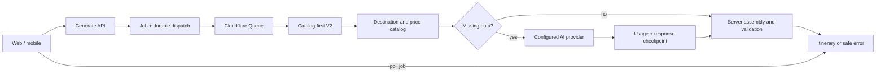

# Generate: runtime and verification

This is the starting point for the current generate flow. Production evidence below is a snapshot, not a guarantee of future availability. For release commands and detailed validation see [production canary](deployment/planning-production-canary.md); for provider configuration see [AI fallback sources](ai-fallback-configuration.md).

Jobs retain their original pipeline; queued V1 jobs are not silently migrated. The catalog-first path uses existing catalog data and only requests missing data. Costs from AI are unverified estimates, not quotes. The server validates route, timing and costs. An unknown AI outcome must not trigger another inference. Queue and ledger recovery preserve the job rather than sending it through V1.

## Baseline verified 2026-11-19

| Item | Evidence |
| --- | --- |
| GitHub main | `1890cdc3a3e9fe618a7c5c36dc7653044ae9cb1d`, PR #45 merged. |
| Open fallback PR | [#46](https://github.com/travan/AI-Powered-_Travel_Planner/pull/46), remote head `38d2346` at baseline. |
| Worker health | Deploy commit `826996e`, V2 100%, Queue bound, one inference slot, Cloudflare primary. Health is not a generation test. |
| Revision drift | `826996e` exists locally and was deployed but was not in PR #46 at baseline. Reconcile before the next release. |
| Canary protection | Gemini fallback has been restricted to CI; verify actual Worker settings and source list before every deployment. Never print secrets. |

## Known evidence

| Finding | Status and limits |
| --- | --- |
| V1 job `8d40383b-8eaa-4be1-94d7-430c9b7344e4` | Historical V1 failure after 18 model calls. Exact validation slot was not available; see [V2 verification](testing/catalog-first-generation-v2.md). |
| Cloudflare V2 | CI Da Nang `43201635-1d2d-4360-bb87-1362b93dfac6` and Ha Giang `8c906691-2431-4583-a219-c65078b60cf1` completed in earlier real tests. These do not establish a population success rate. |
| Gemini short route | Da Nang `c3a08efc-c8d9-4bb3-8dc9-a0884f9e70de` completed with Gemini 3.5 Flash Lite. |
| Gemini service availability | Ha Giang `0120fe0f-3bf4-4fe9-9bb2-9bdaa78ca2a8` returned Google HTTP 503. An earlier 3.8 Flash request timed out; its outcome is unknown. |
| Gemini international routes | Malaysia/Singapore `76e00b88-9217-421e-852f-370eee607edf` and China/Russia `49f0d6a9-838d-42af-a5d8-2b9baf40ba83` returned HTTP 400 INVALID_ARGUMENT. Exact rejected field was not retained. Schema complexity is a hypothesis, not an established root cause. |
| Schema candidate | `826996e` simplifies the Gemini schema. A subsequent Malaysia/Singapore test `0d461cd5-cf27-42aa-8ea6-c6b0c4a2ab9e` received HTTP 503; it did not validate the schema fix. |
| CI simulation | Three-city job `7cf7cd30-6e3f-471b-b69d-c13627182676` completed with Cloudflare despite intended simulated quota. Cause was not established. Always assert the actual provider before treating a test as Gemini evidence. |

## How to inspect a job

1. On the app, open recent planning requests and record the job ID, status, pipeline and safe error. A failed generation is not proof that the model ran.
2. In Cloudflare dashboard open Workers & Pages → `travel-planner-api` → Logs, then filter for the job ID and timestamp. Tail logs with the Wrangler version in the deployment runbook when dashboard access is available. Depending on retention and permissions, old logs may not be available.
3. Compare durable job usage metadata: source ID, provider, model, status, token counts and duration. The CI runner records these in its reports. The synthetic `canary-simulated-quota` entry is not a real Cloudflare inference.
4. Interpret 400 as a rejected request until a safe diagnostic proves more; 503 as provider unavailable; timeout as unknown; and quota exhaustion separately. Do not put raw prompts, model responses or credentials into logs or public errors.

## Configuration and rollout

`AI_PROVIDER` selects the primary; `AI_FALLBACK_PROVIDERS` lists ordered provider/model/secret-name entries. Actual API keys are Worker secrets, never request fields. CI-only is the safe default. Multiple supported model/key entries are configuration changes; a new provider protocol requires an implementation. Fallback follows a definitive quota rejection only; timeouts and uncertain outcomes do not trigger another call.

The exact original Malaysia/Singapore request remains in `tests/fixtures/malaysia-singapore-request.json`; wide-budget and other route fixtures are separate. Live tests submit sequentially with stable idempotency keys and no automatic retry. Promote Gemini beyond CI only after actual provider assertions and all required route validations pass. Preserve the current V2 percentage and Queue for existing jobs during investigation.
